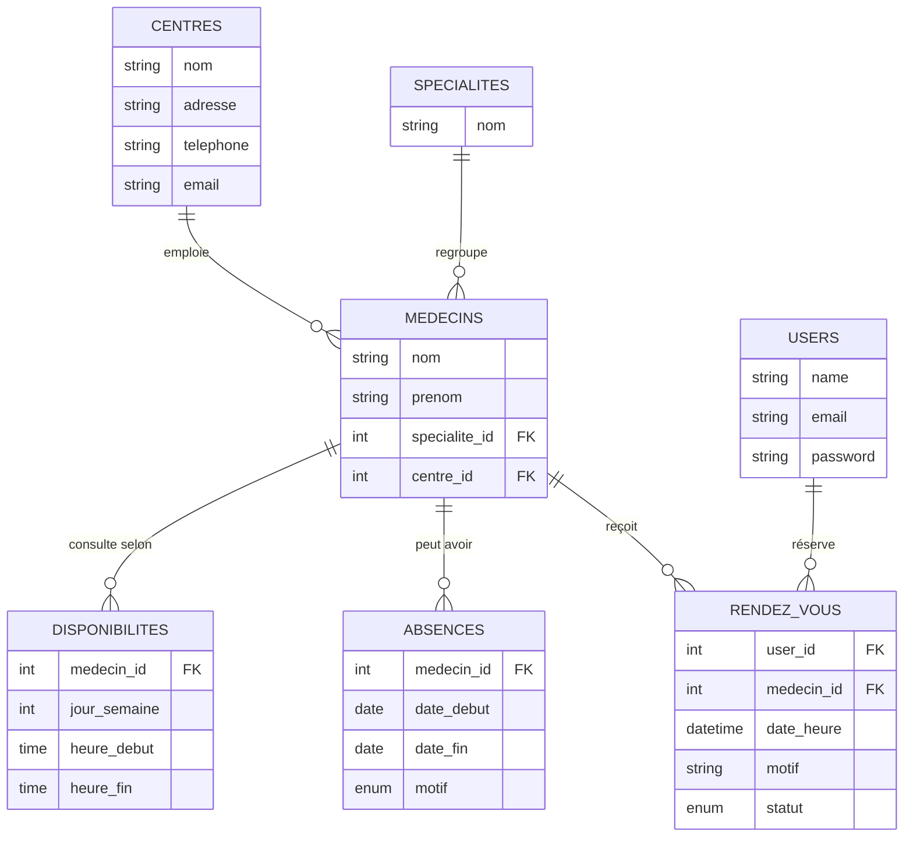

# RDV Medical : prise de rendez-vous médical

Mini-application web permettant à un patient de créer un compte, puis de réserver un rendez-vous dans un centre médical : choix du **centre**, de la **spécialité**, de la **date**, puis d'un **créneau libre** chez l'un des médecins disponibles.

Réalisée dans le cadre du test technique *Développeur(se) Fullstack*.

- **Application en ligne :** _lien à venir_
- **Compte de test :** `patient@test.com` / `password`

---

## Sommaire

1. [Fonctionnalités](#fonctionnalités)
2. [Choix techniques](#choix-techniques)
3. [Modélisation](#modélisation)
4. [Règles métier](#règles-métier)
5. [Installation locale](#installation-locale)
6. [Tests](#tests)
7. [Structure du projet](#structure-du-projet)
8. [Pistes d'amélioration](#pistes-damélioration)

---

## Fonctionnalités

Le périmètre retenu couvre **l'authentification** et **la prise de rendez-vous**. Les centres, spécialités, médecins, horaires et absences sont fournis par le jeu de données d'exemple (pas d'écrans d'administration).

**Authentification**
- Inscription (nom, e-mail, mot de passe confirmé de 8 caractères minimum), avec connexion automatique
- Connexion avec option « Se souvenir de moi », déconnexion
- Pages de rendez-vous réservées aux utilisateurs connectés

**Prise de rendez-vous**
- Choix du centre médical : ses coordonnées (adresse, téléphone, e-mail) s'affichent
- Choix d'une spécialité : seules celles exercées dans le centre choisi sont proposées
- Choix d'une date : chaque médecin s'affiche avec ses créneaux libres, ou avec le motif de son absence
- Page de confirmation récapitulative, avec un motif de consultation facultatif
- Page « Mes rendez-vous » : rendez-vous à venir et historique

**Bonus réalisés**
- ✅ Annulation d'un rendez-vous à venir (le créneau redevient disponible)
- ✅ Interface responsive (Bootstrap 5)
- ✅ Gestion de l'authentification (utilisateur simple : chaque patient a son compte et n'accède qu'à ses propres rendez-vous)
- ✅ 33 tests automatisés (unitaires et fonctionnels)

---

## Choix techniques

| Élément | Choix | Pourquoi |
|---|---|---|
| Backend | **Laravel 8** (PHP ≥ 7.3) | Framework MVC complet : ORM Eloquent, migrations, validation, authentification, tests intégrés |
| Base de données | **MySQL** (moteur InnoDB) | Relationnelle, adaptée aux liens centre / spécialité / médecin / rendez-vous ; InnoDB pour les clés étrangères et les transactions |
| Frontend | **Blade + Bootstrap 5** (CDN) | Rendu serveur simple et rapide à livrer, responsive sans étape de compilation (pas de npm requis) |
| Authentification | Contrôleurs écrits à la main | Code court et lisible, sans dépendance supplémentaire (Breeze, Jetstream…) pour un besoin simple |
| Tests | **PHPUnit** + SQLite en mémoire | Rapides et isolés : la base de développement n'est jamais touchée |

**Points d'architecture**
- **Les règles métier sont isolées** dans deux services : `CreneauService` calcule les créneaux libres d'un médecin et `ReservationService` applique les règles de réservation, puis crée le rendez-vous. Le contrôleur reste fin.
- **Les créneaux ne sont pas stockés** : ils sont calculés à la volée à partir des horaires hebdomadaires, des absences et des rendez-vous existants. Il n'y a ainsi aucune donnée à synchroniser quand un horaire ou une absence change.
- **Les réservations simultanées sont sécurisées** : les vérifications et la création du rendez-vous se font dans une transaction, avec un verrou (`SELECT … FOR UPDATE`) sur le médecin et sur le patient. Deux patients ne peuvent pas obtenir le même créneau, et un double clic ne crée pas deux rendez-vous.
- **Sécurité** : mots de passe hachés (bcrypt), protection CSRF, régénération de la session à la connexion, limitation à 5 tentatives de connexion par minute, vérification qu'un patient n'annule que ses propres rendez-vous.
- Interface et messages de validation **en français**.

---

## Modélisation



| Table | Rôle |
|---|---|
| `centres` | Centres médicaux : nom, adresse, contact (téléphone, e-mail) |
| `specialites` | Spécialités médicales (nom unique) |
| `medecins` | Un médecin a **une** spécialité et **un** centre d'affectation ; une spécialité peut être rattachée à plusieurs médecins |
| `disponibilites` | Horaires hebdomadaires de consultation (jour ISO : 1 = lundi … 7 = dimanche). Un médecin peut avoir plusieurs plages par jour (ex. 8h-12h et 14h-17h) |
| `absences` | Périodes d'absence d'un médecin, avec un motif : `maladie`, `conges` ou `autre` |
| `rendez_vous` | Rendez-vous d'un patient avec un médecin, avec un statut : `confirme` ou `annule` |
| `users` | Comptes patients |

Les migrations Laravel se trouvent dans `database/migrations/` et leur équivalent SQL dans `database/sql/schema.sql`.

---

## Règles métier

Une consultation dure **30 minutes**. Un créneau est proposé, puis accepté à la réservation, seulement si :

1. il est compris dans une plage de disponibilité du médecin pour ce jour de la semaine ;
2. le médecin **n'est pas absent** ce jour-là (maladie, congés ou autre) ;
3. il n'est **pas déjà réservé** (un rendez-vous annulé libère le créneau) ;
4. il n'est **pas déjà passé**.

Côté patient :

5. un patient ne peut avoir qu'**un seul rendez-vous à venir par médecin**. Pour changer de date, il annule le premier puis en reprend un. Un rendez-vous annulé ou passé ne compte pas ;
6. un patient ne peut pas avoir **deux rendez-vous à la même heure**, même avec des médecins différents.

Ces règles sont vérifiées dès la page de confirmation, pour prévenir le patient au plus tôt, puis de nouveau au moment de la réservation, dans une transaction. Un créneau envoyé à la main dans la requête, hors horaires ou pendant une absence, est donc refusé. Un rendez-vous ne peut être annulé que par son auteur et seulement s'il est à venir.

---

## Installation locale

### Prérequis
- PHP 7.3 ou supérieur (extensions `pdo_mysql`, `mbstring`, `openssl` ; `pdo_sqlite` pour les tests)
- Composer
- MySQL 5.7+ ou MariaDB (par exemple via WAMP, XAMPP ou Laragon)

### Étapes

```bash
# 1. Récupérer le projet
git clone <url-du-depot> PriseDeRendezVousMedical
cd PriseDeRendezVousMedical

# 2. Installer les dépendances PHP
composer install

# 3. Créer le fichier de configuration et la clé de l'application
cp .env.example .env
php artisan key:generate
```

4. Créez une base de données MySQL vide nommée `prise_rendezvous_medical_db` (encodage `utf8mb4`). Si besoin, adaptez les variables `DB_*` dans `.env` (utilisateur, mot de passe…).

5. Créez les tables et chargez les données d'exemple, au choix :

   **Option A : avec Laravel (recommandée)**
   ```bash
   php artisan migrate --seed
   ```
   Les absences des médecins sont alors calculées à partir de la date du jour, ce qui garantit des cas de test valides.

   **Option B : avec les scripts SQL**
   ```bash
   mysql -u root -p prise_rendezvous_medical_db < database/sql/schema.sql
   mysql -u root -p prise_rendezvous_medical_db < database/sql/donnees.sql
   ```
   (ou via phpMyAdmin > Importer, dans le même ordre). Les dates d'absence sont alors celles du jour de génération des scripts.

6. Lancez l'application :
   ```bash
   php artisan serve
   ```
   puis ouvrez <http://127.0.0.1:8000>.

Pour remettre la base à zéro avec les données d'exemple : `php artisan migrate:fresh --seed`.

### Utilisateur de test

| E-mail | Mot de passe |
|---|---|
| `patient@test.com` | `password` |

Vous pouvez aussi créer votre propre compte depuis la page d'inscription.

### Données d'exemple

- **3 centres :** Centre Médical Pasteur, Clinique Les Palmiers, Polyclinique Espoir
- **5 spécialités :** Médecine générale, Cardiologie, Pédiatrie, Dermatologie, Gynécologie
- **10 médecins**, la plupart consultant du lundi au vendredi (8h-12h et 14h-17h), avec deux horaires particuliers :
  - Dr Bah (Pédiatrie) : lundi, mercredi et vendredi, 9h-13h
  - Dr Kouyaté (Dermatologie) : mardi, jeudi et samedi, 8h30-12h30
- **3 absences** pour tester la règle métier :
  - Dr Diallo (Cardiologie, Centre Médical Pasteur) : maladie, du jour du seed à J+2
  - Dr Sylla (Médecine générale, Clinique Les Palmiers) : congés, toute la semaine suivante
  - Dr Condé (Médecine générale, Polyclinique Espoir) : motif « autre », le prochain jour ouvré

---

## Tests

```bash
php artisan test
```

Les tests s'exécutent sur une base **SQLite en mémoire** (configurée dans `phpunit.xml`) et fixent la date courante, ce qui les rend indépendants de la base locale et du jour d'exécution.

| Fichier | Ce qui est vérifié |
|---|---|
| `tests/Unit/CreneauServiceTest.php` | Calcul des créneaux : découpage en 30 min, jours sans consultation, absences, créneaux réservés ou annulés, créneaux passés |
| `tests/Feature/AuthTest.php` | Inscription, connexion, mauvais mot de passe, déconnexion, accès refusé aux visiteurs |
| `tests/Feature/RendezVousTest.php` | Parcours de réservation, refus d'un créneau déjà pris, pendant une absence ou hors horaires, un seul rendez-vous à venir par médecin, pas deux rendez-vous à la même heure, annulation, interdiction d'annuler le rendez-vous d'un autre patient ou un rendez-vous passé |

---

## Structure du projet

```
app/
├── Http/Controllers/
│   ├── Auth/LoginController.php       # Connexion / déconnexion
│   ├── Auth/RegisterController.php    # Inscription
│   └── RendezVousController.php       # Parcours de réservation, liste, annulation
├── Models/                            # Centre, Specialite, Medecin, Disponibilite, Absence, RendezVous, User
├── Exceptions/ReservationImpossible.php  # Erreur métier affichée au patient
└── Services/
    ├── CreneauService.php             # Calcul des créneaux libres d'un médecin
    └── ReservationService.php         # Règles de réservation et création du rendez-vous
database/
├── migrations/                        # Création des tables (Laravel)
├── seeders/                           # Jeu de données d'exemple (Laravel)
├── factories/                         # Générateurs de données pour les tests
└── sql/
    ├── schema.sql                     # Script SQL de création des tables
    └── donnees.sql                    # Script SQL du jeu de données
resources/views/
├── layouts/app.blade.php              # Mise en page commune
├── auth/                              # Connexion, inscription
└── rendez-vous/                       # Réservation, confirmation, mes rendez-vous
routes/web.php                         # Routes de l'application
tests/                                 # Tests unitaires et fonctionnels
```

---

## Pistes d'amélioration

- Espace d'administration pour gérer les centres, spécialités, médecins, horaires et absences
- Espace médecin pour consulter son agenda
- Envoi d'un e-mail de confirmation et de rappel au patient
- Navigation par semaine et affichage du prochain créneau disponible de chaque médecin
- Durée de consultation paramétrable par médecin ou par spécialité
